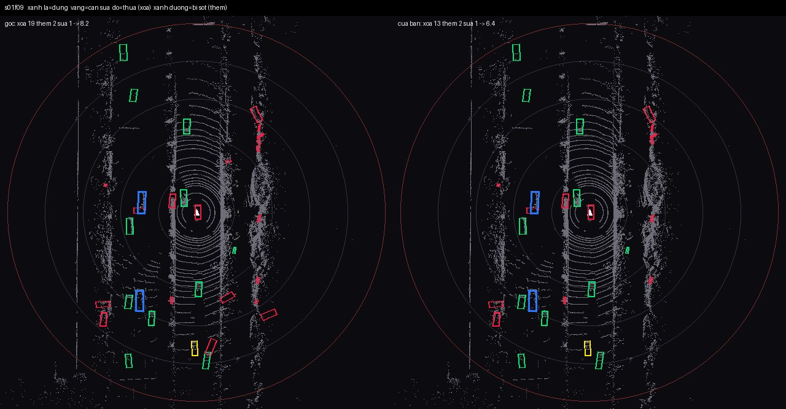

# Báo cáo Day 14 — Võ Khắc Xuân Nguyên - 2A202603122

> Sao chép file này thành `report/individual/<MSSV>_<HoTen>.md` (không dấu), ví dụ `2A20260000_NguyenVanAn.md`.

- Mã học viên dùng với `--student`: `122`
- `seed_tag` trong `frames_A.txt`: `393590736f`

## 1. Dự đoán trước sweep (bước 5b)

Ghi **trước** khi chạy `scripts/pp_sweep.py`, rồi commit và push ngay (lịch sử commit là bằng chứng thời điểm viết). Không sửa phần này sau khi có kết quả.

- Tham số tôi nghĩ giảm công sửa nhiều nhất: tham số giảm công sửa nhiều nhất là score_thr = 0.3
- Vì sao (nhìn ảnh BEV tập A: box thừa nhiều hay box sót nhiều?): vì score_thr thấp chỉ 0.1 nếu tăng score lên thì có thể giảm được box phải xóa nhưng có thể bỏ sót box nên cần phải thêm thì chi phí sẽ tăng lên vì thêm 1 box tốn 1 điểm còn xóa 1 box chỉ tốn 0.3.

## 2. Tập A: sửa tay và tune

| Cấu hình | Xóa | Thêm | Sửa | Chi phí |
|---|---:|---:|---:|---:|
| Gốc | 52 | 5 | 3 | 22,1 |
| `best_config.json` | 36 | 7 | 3 | 19,3 |

- Tham số đã đổi trong `best_config.json`: 0.3
- Kết quả leave-one-out (dán các dòng `scripts/pp_sweep.py` in ra):
    s01f09: cấu hình chọn {'score_thr': '0.3', 'min_points': '10'} → 6.4 (tốt nhất có thể 5.0)
    s02f11: cấu hình chọn {'score_thr': '0.5', 'min_points': '0'} → 7.2 (tốt nhất có thể 3.7)
    s03f24: cấu hình chọn {'score_thr': '0.3', 'min_points': '10'} → 9.2 (tốt nhất có thể 9.2)
- Cấu hình có ổn định trên từng frame không? Vì sao tôi vẫn chọn (hoặc không chọn) nó: 
    Kết quả leave-one-out cho thấy cấu hình được chọn chưa ổn định. Khi giữ lại s01f09 hoặc s03f24 để chấm, hai frame còn lại đều dẫn đến score_thr=0.3, min_points=10. Khi giữ lại s02f11, kết quả chọn đổi thành score_thr=0.5, min_points=0, với chi phí 7,2 trên frame này so với mức thấp nhất có thể là 3,7.
    Tôi vẫn chọn score_thr=0.3, min_points=10 vì tổ hợp này có tổng chi phí thấp nhất trong 15 cấu hình đã thử trên tập A, giảm từ 22,1 xuống 19,3 (12,7%). Tôi sẽ áp dụng cấu hình này cho tập B để đánh giá trên các frame chưa dùng để tinh chỉnh.

## 3. Trước/sau (bước 8)

- `scripts/pp_compare.py` báo giảm (hoặc tăng) 13% công sửa trên tập A.
- Dự đoán ở mục 1 đúng hay sai? Giải thích bằng số box xóa/thêm/sửa: Dự đoán đúng. Chỉ tăng score_thr từ 0,1 lên 0,3 đã giảm chi phí từ 22,1 xuống 19,9. Với cấu hình cuối, số hộp cần xóa giảm từ 52 xuống 36, số hộp cần thêm tăng từ 5 lên 7 và số hộp cần sửa vẫn là 3. Tổng chi phí còn 19,3, giảm khoảng 13%.

## 4. Tập B

Số đo từ `scripts/pp_prelabel.py --frames d14_<ID>/frames_B.txt --config d14_<ID>/best_config.json --gt d14_<ID>/ref_B.json`:

| Xóa | Thêm | Sửa | Chi phí |
|---:|---:|---:|---:|
| 137 | 15 | 9 | 60.6 |

- Loại box tốn công sửa nhất ở tập B: Car tốn công sửa nhất, chủ yếu do có 85 hộp dự đoán thừa phải xóa.

## 5. Giới hạn

- Nêu ít nhất 2 giới hạn (ví dụ: chỉ 3 frame tune; model KITTI không có Truck/Bus; chi phí là công thức, chưa phải thời gian sửa thật): 
    - Cấu hình chỉ được tinh chỉnh trên 3 frame tập A nên kết quả có thể thiếu ổn định trên các frame khác.
    - Mô hình huấn luyện trên KITTI chưa học trực tiếp hai lớp Truck và Bus, nên các hộp thuộc hai lớp này vẫn cần kiểm tra thủ công.
